<div align="center">

<picture>
  <source media="(prefers-color-scheme: dark)" srcset="./assets/chat-dark.svg">
  <source media="(prefers-color-scheme: light)" srcset="./assets/chat-light.svg">
  
</picture>

</div>

### 🧑‍💻 `victor.ts`

```ts
const victor = {
  basedIn: "🇬🇧 United Kingdom",
  role: "Full-stack developer",
  building: ["AI-powered products", "real-time communication tools 🎙️"],

  stack: {
    web:    ["TypeScript", "React", "Next.js", "Vite", "TanStack Query", "shadcn/ui"],
    server: ["Node.js", "Fastify", "Go", "Python", "Prisma", "PostgreSQL"],
    mobile: ["Swift"],
    ai:     ["Claude", "Gemini", "agents that join group chats"],
    cloud:  "☁️",
  },

  caresAbout: [
    "a scroll position that never jumps",
    "WebSockets that reconnect and replay by seq",
    "green CI ✅",
  ],

  currently: "teaching chat UIs to keep up with streaming AI replies",
} satisfies Developer;
```

### 🧰 Toolbox

<p>
  
</p>

### 🔭 What I've shipped lately

| | Project | What it does |
|---|---|---|
| ⚡ | **[sogna-virtual-list](https://github.com/Victor-ChanX/sogna-virtual-list)** <br/> [](https://www.npmjs.com/package/sogna-virtual-list) | A lightweight React virtual list for chat, feeds and logs. Keeps the viewport steady while you prepend history, append messages or **stream text into a row**: Fenwick-tree O(log n) offsets, one shared `ResizeObserver`, zero runtime deps. |

### 🕰️ `git log --oneline victor`

```text
a1b2c3d (HEAD -> main) feat: AI agents that join group chats and talk back 🤖
9f8e7d6 feat: publish sogna-virtual-list to npm ⚡
5c4b3a2 refactor: Vue → React → Next.js, picked up Go, Python & Swift on the way
3e2d1c0 feat: WeChat mini programs, pull-to-refresh and many search boxes 📱
1a0b9c8 chore: scrape the whole internet with Python 🕷️ (for learning, promise)
0000001 init: hello world via freeCodeCamp 🔥 (2017)
```

<picture>
  <source media="(prefers-color-scheme: dark)" srcset="https://raw.githubusercontent.com/Victor-ChanX/Victor-ChanX/output/snake-dark.svg">
  <source media="(prefers-color-scheme: light)" srcset="https://raw.githubusercontent.com/Victor-ChanX/Victor-ChanX/output/snake-light.svg">
  
</picture>

### 💬 Say hi

The chat window above is just an SVG, but I'm real and I reply 😄 Open an issue on any repo, or find me at **[oriarbor.com](https://oriarbor.com/)**.

<div align="center">


<sub>Built like a chat app: messages stream in, scroll stays put. 📜</sub>

</div>
